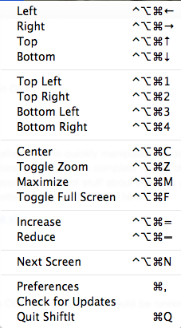

<h1>ShiftIt</h1>

*Managing window size and position in macOS and Windows*

# About

This is a fork of [fikovnik/ShiftIt](https://github.com/fikovnik/ShiftIt) that
builds **natively for Apple Silicon (arm64)**. The upstream project is no
longer maintained and its latest release is Intel-only; this fork updates the
build and code so ShiftIt keeps working on modern macOS. It also contains a
**Windows port** (see [Windows version](#windows-version)) with the same core
actions.

ShiftIt is an application that allows you to quickly manipulate window
position and size using keyboard shortcuts. It is a complete rewrite of the
original [ShiftIt](http://code.google.com/p/shiftit/) by Aravindkumar
Rajendiran which is no longer under development.

License: [GNU General Public License v3](http://www.gnu.org/licenses/gpl.html)

## Download

Build it yourself (see [Local build](#local-build)) — the result is a single
arch `arm64` app. There is no signed release, so no pre-built download is
offered. For Windows, see [Windows version](#windows-version) — one command,
no toolchain required.

## Installation

1. Copy `ShiftIt.app` to `/Applications`.
2. Launch it (unsigned app: right-click → *Open* → *Open* the first time).
3. **Grant accessibility access** — ShiftIt shows a dialog; click
   *Open System Preferences* and turn ON the switch next to ShiftIt under
   *System Settings → Privacy & Security → Accessibility*, then click
   *Recheck* in the dialog.

ShiftIt only needs this once. Note that the app is ad-hoc signed, so if you
**rebuild** it, macOS treats it as a different app and authorization must be
repeated (see the [FAQ](#i-rebuilt-shiftit-and-accessibility-stopped-working-why)).

## User guide

ShiftIt installs itself in the menu bar (optionally it can be completely
hidden). It provides a set of actions that manipulate window positions and
sizes:



Normally, all Cocoa windows and X11 windows are supported (X11 requires
[XQuartz](https://www.xquartz.org/) to be installed). Some applications might
not work correctly or not at all; there is a
[list of known problems](https://github.com/fikovnik/ShiftIt/wiki/Application-Compatibility-Issues)
in the upstream wiki.

## Requirements

* macOS 10.13+, Apple Silicon (arm64)
* Windows 10 1703+ (for the Windows port in `windows/`)

## FAQ

##### How do I turn on/off windows cycling sizes with multiple hotkey presses?

If this feature is on, snapping to the left side of the screen (and top, bottom, and right sides) will resize the window to half of the screen.  If window is then snapped to the same side of the screen, it will resize to one third of the screen, and then two thirds of the screen.

If the feature is off, additional snappings will have no effect and the window will remain at half of the screen.

Currently, the only way to accomplish this is by running commands on the command line.  To turn the feature on, run:
```
defaults write org.shiftitapp.ShiftIt multipleActionsCycleWindowSizes YES
```
To turn it off, run:
```
defaults write org.shiftitapp.ShiftIt multipleActionsCycleWindowSizes NO
```

##### I disabled the _Show Icon in Menu Bar_ in the preferences, how can I get it back?

Launch the application again. It will open the preference dialog.

##### I pressed a shortcut, but nothing has happened, why?

Check that accessibility access is granted: *System Settings → Privacy &
Security → Accessibility* → switch ON next to ShiftIt. If the switch is ON and
shortcuts still do not work, turn it OFF and ON again.

While most application windows work well with ShiftIt, there are some
exceptions (like the GTK+ OSX applications); see the
[list of known problems](https://github.com/fikovnik/ShiftIt/wiki/Application-Compatibility-Issues).

##### I rebuilt ShiftIt and accessibility stopped working, why?

macOS ties accessibility authorization to the app's code signature. ShiftIt is
ad-hoc signed, so every rebuild produces a different signature and macOS treats
it as a different app. Reset the stale record and authorize again:

```sh
$ tccutil reset Accessibility org.shiftitapp.ShiftIt
```

then relaunch ShiftIt and turn the switch ON once more. Day-to-day use (without
rebuilding) is unaffected — authorization persists.

# Windows version

The `windows/` directory contains a native Windows port of ShiftIt's core
functionality: a system tray application (C#, WinForms) that snaps, moves and
resizes the focused window with global keyboard shortcuts. It is a behavioral
port of the macOS geometry engine (`DefaultShiftItActions`), not shared source
code — the macOS app is built on Cocoa/Carbon/Accessibility APIs that do not
exist on Windows.

## Build

No SDK or Visual Studio needed — the build uses the .NET Framework C# compiler
that ships with Windows itself:

```bat
cd windows
build.cmd
```

This produces `windows\ShiftIt.exe` (requires .NET Framework 4.x, present on
every Windows 10/11 installation). Double-click it to run; no installation
step. Use the tray menu's *Run at startup* to auto-start at logon.

## Using it on Windows

`ShiftIt.exe` is a **tray application**: launching it shows no window — only a
notification-area icon (and a balloon confirming it is running, with the main
shortcuts). Keep it running; use *Run at startup* in its tray menu to have it
start at logon. Launching a second copy does not start another instance: the
running one pops its balloon again and the new process exits. To quit,
right-click the tray icon and choose *Exit*.

| Shortcut | Action |
|---|---|
| `Ctrl+Alt+←` / `→` / `↑` / `↓` | snap to left / right / top / bottom half |
| `Ctrl+Alt+Home` / `PgUp` / `End` / `PgDn` | snap to top-left / top-right / bottom-left / bottom-right quarter |
| `Ctrl+Alt+M` | maximize (fill the work area) |
| `Ctrl+Alt+Shift+M` | toggle native maximize/restore |
| `Ctrl+Alt+C` | center the window |
| `Ctrl+Alt+Shift+→` / `←` | move to next / previous screen |

Note the shortcuts do **not** include the Windows key: `Win+Arrows` is
reserved by the OS snap feature. If a shortcut does nothing, another
application may have claimed it first (Intel display drivers famously use
`Ctrl+Alt+Arrows` for screen rotation) — the startup balloon lists any
conflicts, and every action remains available from the tray menu. When a
window cannot be moved at all (e.g. it belongs to an elevated/administrator
application), ShiftIt shows a warning balloon explaining why instead of
failing silently.

All actions are also available from the tray menu. With *Cycle window sizes*
enabled (default, toggle in the tray menu), snapping repeatedly to the same
edge cycles the window between 1/2, 1/3 and 2/3 of the screen — the port of
the macOS `multipleActionsCycleWindowSizes` setting.

Settings are stored in `%APPDATA%\ShiftIt\settings.ini`. Moving between
screens rescales the window proportionally to the target screen's work area,
like on macOS. Windows of elevated (administrator) applications cannot be
moved by a non-elevated ShiftIt — the same kind of restriction as macOS
accessibility authorization. Snap targets use the screen work area (taskbar
excluded) and are aligned to the *visible* window frame, so borders overlap
screen edges exactly on Windows 10/11.

## Scripting / testing

`ShiftIt.exe --once <action> [hwnd]` runs a single action on the focused
window (or the given window handle) and exits; `ShiftIt.exe --help` lists
action ids. A functional smoke test lives in
[windows/test/smoke-test.ps1](windows/test/smoke-test.ps1):

```powershell
powershell -ExecutionPolicy Bypass -File windows\test\smoke-test.ps1
```

## Development

This fork commits directly to `master`.

### Local build

Requirements: Xcode with the macOS 10.13+ SDK (deployment target is 10.13).
Sparkle auto-update was removed; the bundled `ShortcutRecorder.framework` is an
arm64 build of [ShortcutRecorder](https://github.com/Kentzo/ShortcutRecorder).

To build ShiftIt locally just clone the repository and execute the following
command in the `ShiftIt` directory:

```sh
$ xcodebuild -target "ShiftIt NoX11" -configuration Release
```

The `ShiftIt NoX11` target is the recommended one: it is pure Cocoa and needs
no extra dependencies. The `ShiftIt` target additionally builds the X11
driver, which requires XQuartz headers (`/opt/X11/include`) and is loaded via
`dlopen` at runtime:

```sh
$ xcodebuild -target ShiftIt -configuration Release
```

The build lands in the `SYMROOT` you pass (e.g. `SYMROOT=../build`); verify
with `lipo -info` that the binary is arm64.

### Brew Cask

`brew install --cask shiftit` installs the **upstream Intel build**, which runs
under Rosetta only. If you want the native arm64 build, use the local build
above instead.

### Making a release

The old Python 2 / fabric release pipeline (DSA-signed appcast, Travis CI) was
removed along with the Sparkle auto-update it served. To cut a release
manually:

1. Update the version in [ShiftIt/ShiftIt-Info.plist](ShiftIt/ShiftIt-Info.plist)
   — it appears twice: `CFBundleShortVersionString` and `CFBundleVersion`.
2. Build: `xcodebuild -target "ShiftIt NoX11" -configuration Release SYMROOT=build/Release`
3. Package: `ditto -ck --keepParent build/Release/ShiftIt.app ShiftIt-<version>-arm64.zip`
4. Create a GitHub release in your fork and upload the zip.
